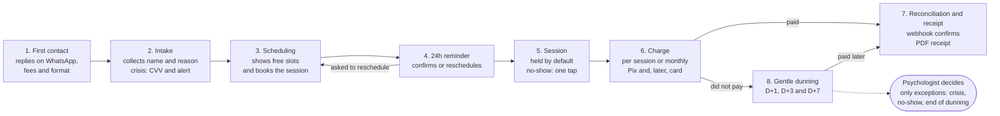
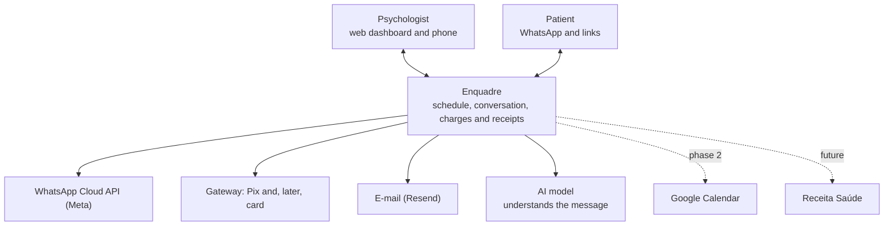

# Automated journey and context

## End-to-end automated journey

From the first "oi" (*"hi"*) on WhatsApp to the receipt, the happy path runs without the psychologist; they are only called on exceptions.

Steps 1 to 4 happen in the WhatsApp conversation; 5 to 8 are triggered by times and events (end of session, due date, payment webhook). Each step is an independent job, so a failure in one does not block the others. In step 6, the patient pays by Pix at launch; once card is enabled, they can also pay on the gateway's page. With a credit card, step 7 happens on approval, but the amount only shows as received when it lands in the psychologist's subaccount; a refund or chargeback reopens the charge and calls the psychologist.

## Context and integrations

Enquadre talks to two people and four external services in the MVP; Google Calendar and Receita Saúde come later.

| Service | What for | Initial choice and reason |
| --- | --- | --- |
| WhatsApp Cloud API | Conversations with patients, reminders, charges | Meta's official API, no intermediary (BSP), to avoid an extra monthly fee. Never use unofficial libraries: the number gets banned |
| Payment gateway | Create charges, receive payment webhooks | Asaas, with a subaccount per psychologist: the money lands in their account and Enquadre only orchestrates. Pix at launch; card later, via the gateway's payment page. Alternatives: Mercado Pago, Efí |
| E-mail | Copies of reminders, receipts, notices to the psychologist | Resend, free tier at first. It is the zero-cost-per-message channel |
| AI model | Classify intent and extract dates and times from free text | Small, cheap model, called only when simple rules don't understand the message |
| Google Calendar (phase 2) | Read personal events so busy slots aren't offered | Read-only, via OAuth |
| Receita Saúde (future) | Official health receipt from Brazil's tax authority | No known public API; the MVP generates a PDF with the data the psychologist enters in the official app |
