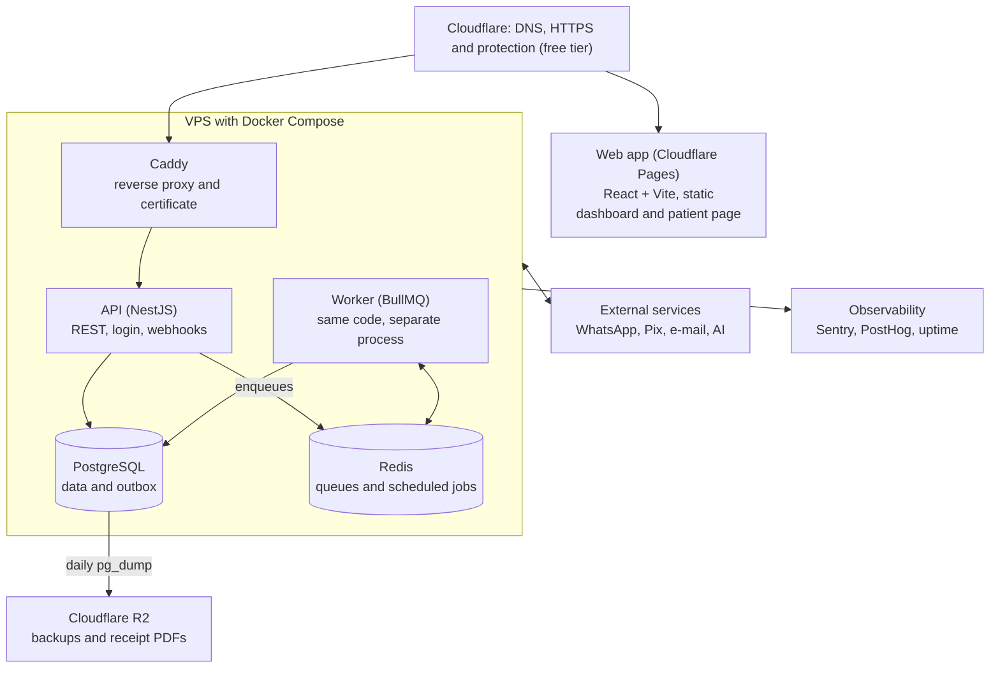

# Containers and infrastructure

The system runs on a single VPS with Docker Compose; the web app is on free static hosting and backups go to object storage. To understand each piece in detail, see `03-study-guide.md`.

| Container | Responsibility | Cost note |
| --- | --- | --- |
| Web app | Psychologist dashboard (PWA installable on the phone) and public patient page | Static, no server |
| Caddy | Automatic HTTPS and routing to the API | Replaces a paid load balancer |
| API | REST endpoints, authentication, webhook intake, business rules | Same Docker image as the worker |
| Worker | Processes queues: messages, reminders, charges, series, dunning, bot | Scales separately from the API when needed |
| PostgreSQL | Source of truth, including the events table (outbox) | On the same server at first; move to managed at 100+ customers |
| Redis | BullMQ execution queues, repeatable jobs, and rate limits; future actions live in PostgreSQL (ADR 0016). AOF on, but losing Redis loses nothing scheduled | Small; 256 MB is enough at first |

## Why a VPS and not Railway or Render (as in the previous plan)

They charge per service and per resource; with API, worker, Postgres, and Redis separate, cost climbs fast. A small VPS runs all five processes for a low fixed price. The trade-off is handling backups and updates, which a script and a cron job solve. If you prefer zero maintenance in the first weeks, Railway is still a valid option; Docker Compose makes switching simple. Decision recorded in `../02-mvp/decisions/0005-vps-with-docker-compose.md`.
