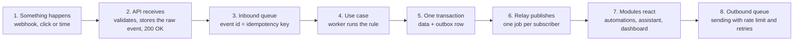

# Backend modules and communication

## Modules

The backend has 9 modules, each owning its own tables; a module never reads another module's table, it only calls that module's public facade or reacts to its events.

| Module | Responsibility | Owns | Publishes events |
| --- | --- | --- | --- |
| `identity` | Sign-up, login, sessions, per-professional isolation | Professional, RefreshToken | `professional.registered` |
| `patients` | Patients and not-yet-converted contacts (leads), consents | Patient, Contact, Consent | `contact.created`, `patient.created` |
| `scheduling` | Availability, free-slot search, series, sessions and their statuses | AvailabilityRule, AvailabilityBlock, SlotHold, AppointmentSeries, Appointment | `appointment.scheduled`, `.confirmed`, `.rescheduled`, `.canceled`, `.ended`, `.no_show` |
| `messaging` | Channels (WhatsApp, e-mail), conversations, 24h window, approved templates, opt-out | Conversation, Message, MessageTemplate | `message.received`, `message.delivered`, `message.failed` |
| `assistant` | Phase 1: reply triage (rule-based crisis, inbox, AI suggestion). Phase 2: the secretary, with a conversation state machine, intent understanding, actions, and handoff to a human | Handoff, TriageSuggestion, AiInvocation, AssistantSession (phase 2) | `handoff.requested`, `crisis.detected`, `triage.suggested` |
| `automations` | Orchestrates time: writes reminders, end of session, monthly charges, and the dunning sequence to `ScheduledAction` according to preferences, and runs each action when it comes due | AutomationSettings, ScheduledAction | none (consumes only) |
| `billing` | Charges, methods accepted per psychologist, gateway integration (Pix and, later, card), payment reconciliation, receipts, dunning sequence | Charge, Payment, Receipt, PayoutAccount, BillingSettings | `charge.created`, `charge.paid`, `charge.overdue`, `payment.received`, `payment.refunded`, `payment.chargeback` |
| `subscription` | The psychologist's Enquadre plan, trial, recurring SaaS billing | Subscription | `subscription.activated`, `.past_due` |
| `privacy` | Audit log, data export and deletion (LGPD, Brazil's data protection law) | AuditLog, DataRequest | none |

Besides the modules, a `platform` layer provides what everyone uses: database, queues, outbox, field encryption, logs, configuration, and an HTTP client with retries. The `records` module (clinical records) is reserved for phase 3, with its own boundaries; see `08-security-lgpd-and-clinical-records.md`.

**Vertical profile.** `messaging`, `automations`, and `assistant` don't mention psychology vocabulary; texts, the risk list, and intents come from `packages/shared/src/vertical/psicologia.ts` (ADR 0015).

**Dependency rule.** `assistant` and `automations` sit at the top: they call the facades of `scheduling`, `patients`, `messaging`, and `billing`. Those four never call the top; they notify via events. The rule is checked in CI with `dependency-cruiser`, so the monolith doesn't turn into a tangle.

**Inside each module** the shape is the same: `api/` (controllers and DTOs), `application/` (use cases, one file per action), `domain/` (entities, rules, and state machines, with no framework dependency), `infra/` (Prisma repositories and external adapters), and `index.ts` (the public facade, the only thing other modules import).

## Communication between the parts

There are three forms of communication: REST between the app and the API, direct facade calls inside the monolith, and events with queues for everything asynchronous or that talks to the outside world.

Step 5 is the *transactional outbox* pattern: the data and the event are written together, so there is never a confirmed session without its reminder scheduled, nor a paid charge without a receipt. The relay runs every second in the worker and marks each row as published.

| Form | When to use | Example |
| --- | --- | --- |
| REST (JSON) | Web app and public page talking to the API | `POST /appointments`, `POST /public/appointments/:token/confirm` |
| Synchronous facade | A module needs an answer now, within the same request | `assistant` asks `scheduling.findFreeSlots()` |
| Event + queue | Effects that can wait, fail, or retry; any external call | `appointment.confirmed` schedules the reminder; `charge.paid` generates the receipt |
| Inbound webhook | A vendor notifying something | Message received (Meta), Pix paid (gateway) |

### BullMQ queues

| Queue | Produced by | Policy |
| --- | --- | --- |
| `inbound-webhooks` | API when receiving webhooks | 5 attempts, exponential backoff; dedupes by event id |
| `domain-events` | Outbox relay | One job per subscriber; one failing doesn't affect the others |
| `scheduled-actions` | `automations` poller, every minute | Execution queue with no delay: receives only actions already due, read from `ScheduledAction` with `FOR UPDATE SKIP LOCKED`. On rescheduling, `automations` cancels the old rows when it receives `appointment.rescheduled` |
| `outbound-messages` | `messaging` | Rate limit per WhatsApp number; respects quiet hours between 9 p.m. and 8 a.m. for non-urgent messages |
| `assistant` | Message received from a patient (triage in phase 1, secretary in phase 2) | One conversation at a time (key = conversation), to keep ordering; the crisis rule runs before any AI call |
| `maintenance` | Cron (repeatable jobs registered in code when the worker starts) | Extends recurring series, cleans up tokens, runs backups, runs the actions poller and the daily sweep for missing reminders |

**Why not delayed jobs.** The future (a reminder three days from now, the D+7 of the dunning sequence) lives in `ScheduledAction`, in PostgreSQL, which is backed up and is the source of truth. Redis only holds work that is due now and repeatable jobs the worker re-registers on every startup. If Redis is recreated, nothing in the future is lost (ADR 0016).

**Real time on the dashboard.** When a patient confirms, the psychologist's dashboard updates on its own via Server-Sent Events, simpler and cheaper than WebSocket for a one-way stream.
