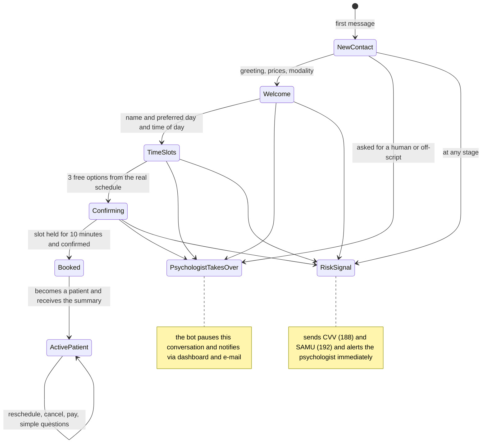
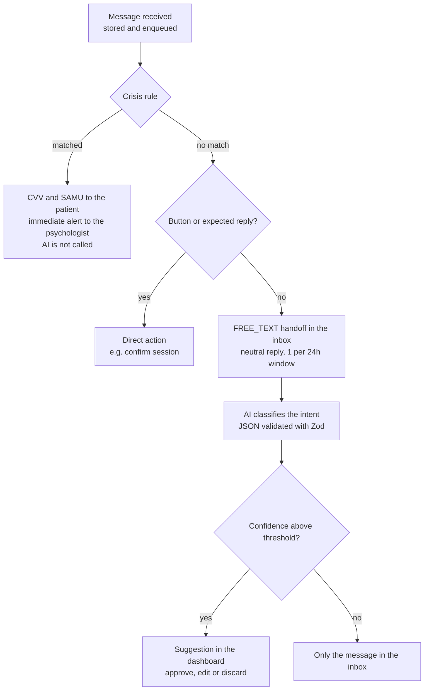
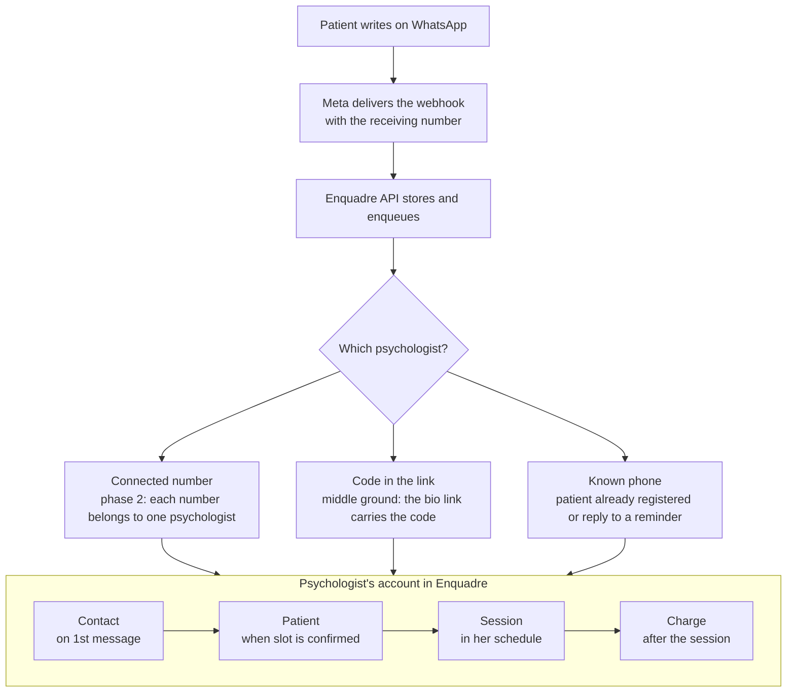

# The WhatsApp secretary

The secretary is a state machine that decides what to do; the AI only translates the patient's free text into an intent and dates, and never writes about health.

## Phase 1: reply triage

Before the secretary exists, the patient already replies to reminders in free text on the Enquadre number. Those messages go through triage (ADR 0014), which reuses the secretary's pieces without holding a conversation:

The psychologist's decision on each suggestion is recorded and becomes the label in the evaluation set. When phase 2 starts, the secretary is born with evaluations based on what patients actually write, and the rate of suggestions approved without edits shows which intents are safe for the secretary to execute on its own.

## How a message is processed (phase 2)

1. The Meta webhook arrives, the message is stored and enters the `assistant` queue, one conversation at a time.
2. Cheap rules go first: WhatsApp buttons and interactive lists ("1", "Terça 14h" (*"Tuesday 2 p.m."*), "Confirmar" (*"Confirm"*)) resolve most replies without AI.
3. If the text is free-form, a small model receives only the current state and the last message and returns JSON validated with Zod: intent, date, time of day, confidence. No patient name or history in the prompt.
4. The state machine executes the action through the module facade (e.g. `scheduling.hold(slot, 10 min)`) and picks the reply from ready-made texts reviewed by the product team.
5. Low confidence twice in a row, a request for a human, or an off-script topic: the bot pauses the conversation and notifies the psychologist.

## Limits the system never crosses

- It does not provide clinical support, does not give health advice, and does not ask for details about the person's distress. It presents itself as a scheduling assistant.
- Risk words and phrases (a list reviewed by psychologists) trigger the reply with CVV (188, 24 hours; Brazil's emotional support and suicide prevention line) and SAMU (192; Brazil's emergency medical service) and an immediate alert to the psychologist, even in the middle of the night. This path is rule-based, not AI-based, so it never fails silently.
- Prices, no-show policy and available times come from configuration; the AI never makes up a price or availability.
- The patient can ask to stop receiving messages; the opt-out is honored on every channel.

## How the patient talks to Enquadre

In the MVP, the patient only receives automated messages from an Enquadre number; in phase 2, they chat with the secretary on the psychologist's own number. In any phase, everything that comes out of the conversation is stored in that psychologist's account.

### Which number the patient uses in each phase

| Phase | Number | The patient can | A new patient's first contact |
| --- | --- | --- | --- |
| Phase 1 (MVP) | An Enquadre number, shared by all psychologists, with a neutral display name | Receive reminders and charges on the psychologist's behalf ("Lembrete da sua sessão com Marta Lima", *"Reminder of your session with Marta Lima"*) and tap Confirmar (*Confirm*) or Remarcar (*Reschedule*). There is no free conversation: free text goes through triage, with rule-based crisis detection and an action suggestion for the psychologist | Still happens on the psychologist's personal WhatsApp, as it does today; they register the patient in the dashboard |
| Middle ground (optional) | The same Enquadre number, plus a unique link per psychologist (Instagram bio, website) | Chat with the secretary, which introduces itself as "Agenda da Marta Lima" (*"Marta Lima's Schedule"*) | Arrives through the link; the secretary welcomes and books |
| Phase 2 | The psychologist's own number, connected to Enquadre | Chat with the secretary on the number they already know | Arrives at the psychologist's number; the secretary welcomes and books, and the psychologist follows everything in the dashboard |

| Strategy | Pros | Cons |
| --- | --- | --- |
| Single Enquadre number (MVP) | A single Meta verification, nothing for the psychologist to configure | First contact still arrives at the psychologist's personal number |
| Own number via Meta's Embedded Signup, as a Tech Provider (phase 2) | The secretary answers on the number patients already know | Requires approval as a Tech Provider and support for each customer's onboarding |

In phase 2, it is worth evaluating coexistence, which allows using the same number in the WhatsApp Business app and the API at the same time; confirm availability and conditions in Meta's documentation before planning around it.

### How the message reaches the right account

The API receives from Meta the identifier of the number that received the message and the phone number of the sender, and applies three rules, in this order:

1. **Connected number (phase 2).** Each connected WhatsApp number is tied to a single psychologist; the message goes to their account.
2. **Code in the link (middle ground).** The unique link opens WhatsApp with a prefilled first message containing the psychologist's code (for example, "Olá! Quero agendar uma sessão. [ML-23]", *"Hi! I'd like to book a session. [ML-23]"*). The code identifies the account.
3. **Known phone.** On the shared number, anyone replying to a reminder or who is already a patient is recognized by their phone number. If the same phone belongs to a patient of two psychologists, the most recent open conversation wins; if there is still doubt, the secretary asks which professional the matter concerns.

If no rule identifies the psychologist, the secretary replies with a neutral message asking for the link or the professional's name, and nothing is created.

### What is created automatically in the psychologist's account

| Moment | What Enquadre creates or updates | Does the psychologist need to do anything? |
| --- | --- | --- |
| First message from someone new | A contact, with phone number and the conversation | No |
| Person gives their name and picks a slot | A 10-minute hold on that slot | No |
| Person confirms the slot | The contact becomes a patient and the first session enters the schedule | Only if they turned on the "aprovar novos pacientes" (*"approve new patients"*) option: one tap to approve |
| After the first session | The question "Manter horário fixo?" (*"Keep a fixed time slot?"*) appears in the dashboard | One tap to set weekly or biweekly; the recurring series is created |
| From then on | Reminders, confirmations, reschedulings, charges and receipts | No, except for no-shows, crises and the end of the dunning sequence |

The recurring series is not created automatically because the fixed time slot is usually agreed during the first session itself. Prices and no-show policy always come from the psychologist's configuration.

## Why the full secretary is in phase 2

The main reason is not cost; it is risk, timeline and validation.

| Reason | Weight | Explanation |
| --- | --- | --- |
| Meta approvals | High | Answering on the psychologist's number requires Enquadre to be approved as a technology provider and each psychologist to connect their number. That takes weeks and doesn't depend on code |
| Conversation safety | High | A secretary that talks to people in distress needs reliable crisis detection, reviewed texts and tests with real conversations before going live |
| Business validation | High | The MVP first proves that psychologists pay for scheduling, reminders and billing. The secretary is the bigger bet and deserves to be built with real users giving feedback |
| Development effort | Medium | It is 4 to 6 extra sprints (state machine, text understanding, conversation inbox in the dashboard, handoff to a human). Added to the MVP, they would delay launch by months |
| Evaluation base | Medium | Phase 1 triage, together with the psychologist's decisions, generates the evaluation set the secretary needs to go live safely |
| Cost | Low | AI costs cents per psychologist. Service messages have 1,000 free per number per month; in phase 2, each psychologist has their own number and their own allowance, which makes conversation nearly free |

If the first interviews show that handling first contact is the biggest pain point, the middle ground with the unique link can come right after the MVP, before phase 2, because it uses the Enquadre number that will already be approved.

## Phase 2 experiment: state machine or agent with tools

ADR 0008 sets the state machine with a classifier as the default. In phase 2, it is worth measuring an alternative without blindly swapping the default: in some low-risk states (for example, rescheduling for an active patient), an agent with restricted tools (`findFreeSlots`, `hold`, `reschedule`) proposes the action, and the same rules layer validates it before executing. Both approaches run against the same evaluation set; the final choice, backed by the numbers, becomes an ADR. The crisis rule and the limits on this page apply to both.
