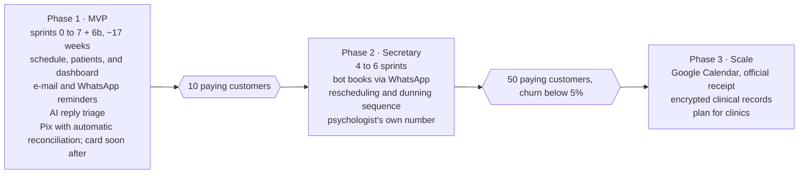

# Phased evolution and decisions

The architecture is designed complete from the start, but the WhatsApp secretary is only built after the MVP has 10 paying psychologists; until then, the `assistant` module handles only reply triage (ADR 0014) and the psychologist's own number remains an empty boundary.

The gates are business criteria, not code criteria: the next phase is only worth building if the previous one proved that people pay and stay. In phase 1, the MVP sprint roadmap still applies, with this architecture's adjustments: VPS instead of Railway in sprint 3, outbox and `automations` in sprint 5, the single WhatsApp number in sprint 5 or 6, the crisis rule and the reply inbox together with the first WhatsApp reminder, and AI triage in sprint 6b. Card comes in a short sprint a few weeks after launch, before phase 2. The middle-ground option of the dedicated link can come right after the MVP if first contact turns out to be the biggest pain.

## Architecture decisions (ADRs)

The full records are in `../02-mvp/decisions/`.

| ADR | Decision | Revisit when |
| --- | --- | --- |
| 0004 | Modular monolith with boundaries checked in CI | A module needs to scale on its own or gets its own team |
| 0005 | Single VPS with Docker Compose | More than 100 customers or a need for high availability |
| 0006 | Transactional outbox + BullMQ for events | Volume that justifies a dedicated broker |
| 0007 | Official WhatsApp Cloud API, no BSP, single number in the MVP | Phase 2, with Meta's embedded signup |
| 0008 | Deterministic state machine; AI only to understand text | If the rules do not cover most conversations |
| 0009 | Gateway with a subaccount per psychologist; multiple methods in the model, only Pix active at launch, card via the gateway's page behind a flag | If the fee weighs on the plan price, or if psychologists ask for their own checkout or recurring card |
| 0010 | Rule-based crisis detection, with CVV and immediate alert | Must never depend on AI alone |
| 0011 | Application-level encryption of sensitive fields | When adding clinical records in phase 3 |
| 0012 | WhatsApp reminder as the default channel, with a free e-mail copy; no "session confirmed" message | If the cost per message exceeds 15% of the plan or the shared number's service free tier runs out |
| 0013 | Clinical records out of the MVP, in an isolated `records` module, with per-psychologist key, 2FA, and auditing | Phase 3, or earlier if it is the main request from paying customers |
| 0014 | Reply triage in phase 1: rule-based crisis detection, reply inbox, AI suggests and the psychologist approves | Approval without edits below 70% after one month of real use |
| 0015 | Vertical profile: `messaging`, `automations`, and `assistant` with no psychology vocabulary in the code | When there is a second niche with paying customers |
| 0016 | Future actions in `ScheduledAction` in PostgreSQL, with a poller and `SKIP LOCKED`; Redis only for execution | If second-level precision is needed or the table requires partitioning |
